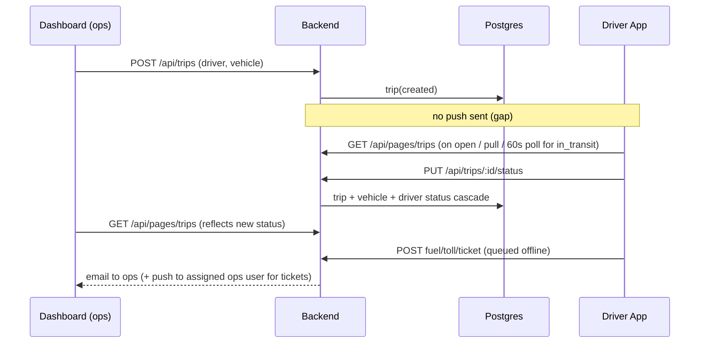

# Workflow analysis

| Workflow | Screen | Endpoint | Backend | Entities | Dashboard impact |
|---|---|---|---|---|---|
| Login | login | `POST /auth/login` | auth.service | User, Organisation, Role, RefreshToken | — |
| Assign trip | (dashboard) | `POST /api/trips` | trips.service.createTrip | Trip, TouchingLocation | trip list |
| See trip | Trips/Detail | `GET /api/pages/trips[/:id]` | pages/trips.handler (driver scope) | Trip, Vehicle, Driver | — |
| Start/Complete | Detail/Home | `PUT /api/trips/:id/status` | trips.service.updateTripStatus | Trip, Vehicle, Driver | status badges, driver availability |
| Fuel / Toll | log screens | `POST /api/fuel-logs`, `/toll-logs` | services + notify | FuelLog, TollLog | logs; email to ops |
| Report issue | ticket/new | `POST /api/tickets` (+photo) | tickets.service, assignment round-robin | Ticket, TicketHistory | ticket board, SLA, email + push to assignee |

## Defects found while tracing
1. **Start/Complete Trip contract mismatch (P0).** App sent `in_transit`; backend `tripStatusSchema` only accepts `in-transit` ⇒ HTTP 400 on every Start. *Fixed in app (wire mapping).*
2. **Driver cannot update trip status (P0, backend/business decision).** `DEFAULT_PERMISSIONS.Driver.trips = R` and `PUT` maps to `canUpdate`, so the guard returns 403 for Drivers unless an org's role rows were edited. If granted, `updateTripStatus` has no driver scoping (any trip in the org). A driver-scoped transition endpoint (or `RU` + ownership check) is needed.
3. **No trip-assignment notification (P1).** Backend never emits `TRIP_ASSIGNED`.
4. **Duplicate risk on replay (P1).** Queued POSTs have no idempotency key; a request that succeeded but lost its response is re-sent on reconnect.
5. **Stale data**: trip detail had no refresh/cache; Home polls only `in_transit`, so a `created` assignment is invisible on Home.
